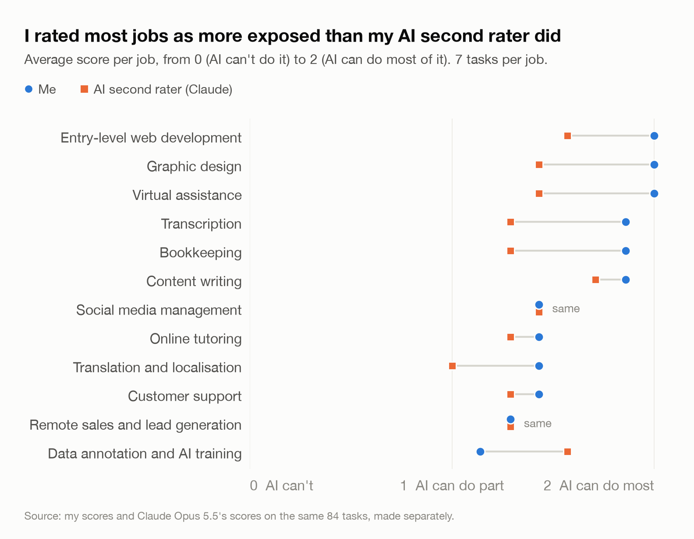
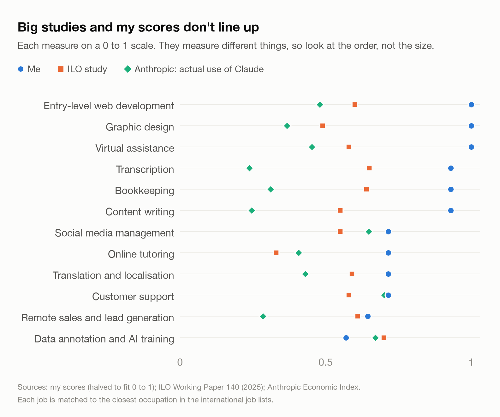

# Which Nigerian remote jobs can AI do? A task-by-task check

*Olaoluwa Oluwasanya · November 2026 · All data, prompts and code: [github.com/vantage-ola/research-analyst-project](https://github.com/vantage-ola/research-analyst-project)*

## The question

Many Nigerians earn in dollars doing remote and freelance work: customer support, writing, bookkeeping, data labelling, and more. I wanted to know which parts of these jobs AI tools can already do, and whether the big international studies on AI and jobs describe this work well.

One thing to be clear about first. This brief asks whether AI **can** do a task well enough that a paying client would accept the work after a quick check. It doesn't predict how many people will lose jobs. A task AI can do may still be done by people, because of cost, trust, access or what the client wants.

## What I did

1. **Chose 12 jobs** Nigerians commonly do remotely: customer support, data annotation, content writing, virtual assistance, bookkeeping, transcription, translation, graphic design, online tutoring, entry-level web development, social media management, and remote sales.
2. **Split each job into 7 tasks**, 84 in total. Most come from O\*NET, the US government's list of what each job involves. I changed some to fit Nigerian work and added 11 that only make sense here, like preparing students for WAEC and JAMB, adding Paystack payments to a website, running PAYE payroll, and transcribing Pidgin.
3. **Scored every task** from 0 to 2:
   - **0:** AI can't do much of it. A person still does the main work.
   - **1:** AI can do part of it or save real time, but a person still does or checks a lot.
   - **2:** AI can do most of it. A person only needs to check it.

   Two of us scored all 84 tasks without seeing each other's answers: me, and an AI model (Claude Opus 5.5) as a second opinion.
4. **Tested 22 tasks for real.** I gave the same work to three AI models (Claude Haiku, Sonnet and Opus) and got 66 answers. I shuffled them and hid which model wrote which, then graded each from 1 (unusable) to 4 (ready to send to a client). The second rater graded them too. I skipped graphic design because it needs image tools.
5. **Compared my results with three published studies:** the ILO's 2025 study of AI exposure by occupation, the "GPTs are GPTs" paper from OpenAI and university researchers, and Anthropic's Economic Index, which tracks what people actually use Claude for.

## What I found

| # | Job | My score (0-2) | Second rater (0-2) | Tested answers, my grade (1-4) | ILO study (0-1) | Actual Claude use (0-1) |
|---|---|---|---|---|---|---|
| 1 | Virtual assistance | 2.00 | 1.43 | 4.00 | 0.58 | 0.45 |
| 2 | Graphic design | 2.00 | 1.43 | not tested | 0.49 | 0.37 |
| 3 | Entry-level web development | 2.00 | 1.57 | 4.00 | 0.60 | 0.48 |
| 4 | Content writing | 1.86 | 1.71 | 3.83 | 0.55 | 0.25 |
| 5 | Bookkeeping | 1.86 | 1.29 | 4.00 | 0.64 | 0.31 |
| 6 | Transcription | 1.86 | 1.29 | 3.50 | 0.65 | 0.24 |
| 7 | Customer support | 1.43 | 1.29 | 4.00 | 0.58 | 0.70 |
| 8 | Translation | 1.43 | 1.00 | 3.67 | 0.59 | 0.43 |
| 9 | Online tutoring | 1.43 | 1.29 | 4.00 | 0.33 | 0.41 |
| 10 | Social media management | 1.43 | 1.43 | 3.83 | 0.55 | 0.65 |
| 11 | Remote sales and lead generation | 1.29 | 1.29 | 3.67 | 0.61 | 0.29 |
| 12 | Data annotation | 1.14 | 1.57 | 4.00 | 0.70 | 0.67 |

### 1. AI does best on text, numbers and admin, and worst on live work

Virtual assistance, web development, writing, bookkeeping and transcription came out on top for both of us. The tasks AI handles worst happen live with another person. We both scored phone calls with customers and handling objections on sales calls as 0. The second rater also gave 0 to live interpreting and keeping young children focused on a video call. I gave those a 1.

### 2. Two people looking at the same task often disagree

We gave the exact same score on half the tasks, and we were never more than one point apart except once. But I scored higher on 33 tasks and the second rater scored higher on 10. Most of our disagreements were about whether AI can do "part" or "most" of a task. That's the hardest line to draw, so treat any single person's AI exposure score with some caution, including mine.

### 3. The AI did better than the cautious guesses

Before testing, the second rater guessed that AI could only partly do bank reconciliation, payroll, scheduling across time zones, Pidgin translation and payment integration. Then the AI did them well:

- Every model reconciled the bank statement to the right balance.
- Every model used the new 2026 Nigerian tax bands correctly.
- All three noticed that the meeting I asked them to schedule was impossible. That was a trick question.

The catch is that my test inputs were short and tidy. Real client work comes as messy 40-page PDFs and bad audio.

### 4. Where AI failed, it failed on Nigerian facts and Nigerian languages

The weakest results were translating into Yoruba and writing a paragraph with Nigerian statistics. One Yoruba answer says "your permit document has been sent to you" when it should say "your order has shipped". One paragraph took a 2016 figure for how many Nigerians were *excluded* from banking and presented it as the number *included*. Two sales emails added details the brief never gave. A foreign client wouldn't catch these mistakes, but a Nigerian freelancer would.

### 5. The big studies don't fit this work well

- **No matching tasks:** 17 of my 84 tasks have no match in the US job list the studies are built on. Six of the seven data annotation tasks have none. Data labelling for AI companies is one of the fastest-growing remote jobs for Nigerians, and these studies barely see it.
- **A different order:** across the 12 jobs, my scores, the ILO study and actual Claude use all rank the jobs in different orders.
- **Capable but not used:** transcription and content writing score high on what AI could do and low on what people actually use it for.

With only 12 jobs, I wouldn't read much into the exact gaps. The point is that the measures don't agree.

## Why my results differ from the studies

Partly because each study asks a different question:

- **GPTs are GPTs:** counts a task as exposed if AI can cut the time it takes in half.
- **The ILO:** scores whole occupations, using task lists built from Poland's job classification.
- **Anthropic's index:** counts what people actually use Claude for, not what it could do.
- **My scoring:** asks whether a client would accept the result.

There are also Nigerian reasons I couldn't measure this time, so I'm treating them as ideas to test:

- **Language:** AI is weaker in Yoruba and Pidgin.
- **Payment:** paid AI tools and ad accounts often reject Nigerian cards.
- **Power and data:** they cost money and cut out.
- **Trust:** a lot of this work depends on trust and referrals, not just output.

A survey of Nigerian workers would test these. I planned one but didn't run it this round.

## Link to Nigeria's AI strategy

For my second project, I read Nigeria's National AI Strategy (September 2025) and four other African AI strategies in full, and compared what they promise. The full write-up is in `policy-comparison/output/brief.md`. These are the points that connect to this study. Page numbers are PDF pages of Nigeria's strategy.

- **Skills with no deadline.** The strategy aims to "reduce unemployment by five percentage points by equipping at least 70%" of 16 to 35 year olds with AI skills (p35). It gives no date. The tasks this study found most exposed are the entry-level text, admin and code work many young Nigerians use to start remote careers.
- **A jobs study with no owner.** It plans a "horizon scan/foresight study" to "identify industries and job roles most susceptible to automation" (p45). This study is a small version of that work, covering 84 tasks across 12 jobs. In the strategy, it has no owner, date or budget.
- **Protections that assume a formal job.** It lists "retraining programmes, tailored unemployment benefits" as examples for future laws (p45). Most workers in this study are freelancers paid per task by foreign clients.
- **No Nigerian languages.** It aims to replicate "Nigeria's social context and cultural diversity with AI tools" (p38), but never names Yoruba, Hausa, Igbo or Pidgin. This study's clearest failures were in Yoruba and Nigerian facts. By comparison, Egypt's strategy commits to "fine-tuning Large Language Models for Arabic language use" (p27 of Egypt's document).
- **Nothing on this kind of work.** The strategy never mentions data annotation, freelancing or remote work.

To be fair, Nigeria's strategy is one of only two of the five with any plan for workers whose jobs AI affects. The other is the African Union's. Nigeria's AI law status should be rechecked before publishing: as of 23 October 2026 its AI bill was still described as "proposed", and I found no AI law in force.

## What this doesn't tell you

- **The second rater is an AI.** It's from the same company as the models I tested. It graded without knowing which model wrote each answer, but it may still favour its own style. Treat it as a second opinion, not the truth.
- **I graded generously.** I gave all 66 answers a 3 or a 4, didn't write comments, and didn't record the fact checks I meant to do. I missed several mistakes the second rater found. I've kept my grades as they were, so my "tested answers" column probably makes the AI look better than it is. My grades also couldn't tell the three models apart (3.8 to 3.9 out of 4). The second rater's grades could: Haiku 3.2, Sonnet 3.7, Opus 3.7.
- **No workers were asked.** These are expert judgments, not the experience of people who do the work.
- **Only one AI company.** All three models I tested were Claude. I didn't test ChatGPT, Gemini or free models, and each task ran only once.
- **Short, clean tests.** Real client work is messier.
- **Rough matching.** Each job is matched to the closest occupation in international job lists. For four jobs the match is weak.
- **Not a prediction.** None of this says how many jobs will change, how fast, or what happens to pay.

## How I checked this

- I checked every task ID against the official O\*NET database. The script stops if an ID doesn't belong to the job it's matched to.
- I ran each test in a fresh, empty AI session with no extra instructions. A test run confirmed nothing extra was getting in.
- I shuffled the answers and hid the model names before grading. I only looked up which model wrote what after both of us had finished.
- The second rater checked these facts:
  - the tax bands, against published summaries of the Nigeria Tax Act 2025
  - the banking figures, against EFInA and World Bank reports
  - the reconciliation and physics answers, by hand
  - the payment code, which was checked to make sure it at least runs
- I'm a Yoruba speaker, and I checked the Yoruba answers myself.
- The payment code wasn't tested against Paystack itself.
- For readers who want the statistics: on task scores, the agreement score between the two of us (weighted Cohen's kappa) was 0.20, which counts as weak. On graded answers it was also 0.20. Rank correlations between my scores and the ILO and Anthropic measures were about -0.25.
- All data, prompts, AI answers, grades and code are public. Running `analysis/analysis.py` rebuilds every number here.
