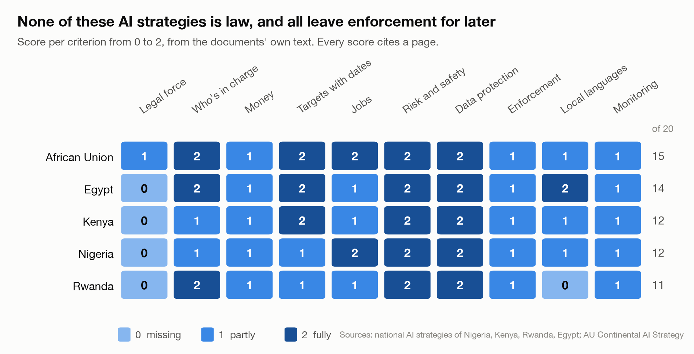

# What African AI strategies promise, and where they're vague

*Olaoluwa Oluwasanya · November 2026 · All data, scores and code: [github.com/vantage-ola/research-analyst-project](https://github.com/vantage-ola/research-analyst-project)*

## The question

Several African countries have published national AI strategies. I wanted to know what they actually commit to, where they're vague, and whether Nigeria's strategy fits what my first study found about which Nigerian remote jobs AI can do.

## What I compared

Five documents, each read in full from the original. News coverage wasn't used.

| Document | Date | Pages |
|---|---|---|
| Nigeria, National AI Strategy | Sept 2025 | 81 |
| Kenya, AI Strategy 2025 to 2030 | Mar 2025 | 91 |
| Rwanda, National AI Policy | 2023 | 23 |
| Egypt, National AI Strategy, 2nd edition | 2025 | 52 |
| African Union, Continental AI Strategy | July 2024 | 66 |

I planned to include South Africa, but its draft policy was withdrawn in April 2026 and is being rewritten, so I used Egypt instead.

Each document was scored on 10 questions, from 0 (missing) to 2 (fully there). The questions were: is it law, who's in charge, money, targets with dates, jobs, risk and safety, data protection, enforcement, local languages, and monitoring. Every score cites a page and a short quote. I also listed the vaguest promises in each document, and checked for three AI safety topics.

## The scores

The full scores, with the page and quote behind each one, are in `data/final_scores.csv`.

## Five observations

### 1. None of them is law, and none can be enforced yet

- **Legal standing:** the AU strategy was adopted by the AU Executive Council (p5). The four national documents describe themselves as strategies or roadmaps. Nigeria's calls itself "a living document" (p4).
- **Enforcement:** every document pushes it into the future:
  - Kenya will "develop an AI and Other Emerging Technologies Act" as AI matures (p79).
  - Egypt's AI law is "in its final development phase" (p10).
  - Nigeria has no AI law in force. As of 23 October 2026, its AI bill was still described as "proposed".

### 2. Nobody says both how much money and where it comes from

All five score 1 on money:
- **Egypt** gives a range, a "national AI fund equivalent of $430-860M" (p46), but not where it comes from.
- **Kenya** points to the national R&D budget (p80) with no AI-specific amount.
- **Nigeria** says it will "secure additional funding from the public and private sectors" (p54).

A strategy without a budget is a list of hopes.

### 3. Many promises have no owner, number, date or money

The two scoring passes logged 70 vague commitments across the five documents. Some examples:

- Kenya: "Potential job displacement will be proactively addressed." (p62)
- Egypt: "ensure that the domestic talent cultivated in Egypt remains in the country" (p23)
- Rwanda: "Rwanda's school curricula shall adapt for the age of AI" (p6)
- Nigeria: "Support green AI projects and innovations across sectors." (p43)

Monitoring is also weak everywhere. Each document promises reviews or indicators, but none names both who reviews progress and when. The AU comes closest, with a midterm review in 2027 (p64).

### 4. "AI safety" mostly means ethics and data protection

- **What they all cover:** all five link to a named data protection law, and all five mention testing or auditing AI.
- **What few cover:** only Kenya and the AU mention reporting AI incidents.
- **Frontier risk:** none of the four national documents mentions risks from the most capable AI models. The AU is the only exception. It says the AU Commission will take part in "global debates around AI governance and future planetary and existential risks of AI" (p61), without any measure of its own.

For governments focused on adoption, that may be a reasonable priority. But it means these documents say nothing about how the most powerful models would be tested before use in Africa.

### 5. Nigeria's strategy doesn't reach the workers my first study looked at

| Nigeria's strategy says | What my first study found |
|---|---|
| "reduce unemployment by five percentage points by equipping at least 70%" of 16 to 35 year olds with AI skills (p35). There's no deadline. | AI already does much of the entry-level text, admin and code work young Nigerians use to start remote careers. |
| It plans a "horizon scan/foresight study" to "identify industries and job roles most susceptible to automation" (p45). It has no owner, date or budget. | A small version of that study, covering 84 tasks across 12 remote jobs. |
| It lists "retraining programmes, tailored unemployment benefits" as examples for future legislation (p45). | Most remote workers are freelancers paid per task by foreign clients, outside the formal jobs these protections assume. |
| It aims to replicate "Nigeria's social context and cultural diversity with AI tools" (p38). It never names Yoruba, Hausa, Igbo, Pidgin or any Nigerian language. | AI's clearest failures were in Yoruba and Nigerian facts. |

The strategy never mentions data annotation, freelancing or remote work.

To be fair, Nigeria is one of only two documents with plans for workers whose jobs AI affects. The AU is the other. Egypt, Kenya and Rwanda only have skills goals. Egypt commits to "fine-tuning Large Language Models for Arabic language use" (p27). Nigeria's minister has called for local-language AI in public since, but that isn't in the strategy.

## What this doesn't tell you

- **The scores came from AI, not people.** Two AI models (Claude Opus 5.5 and Sonnet 5.5) scored every document separately, without seeing each other's answers. They agreed on 45 of 50 scores (weighted Cohen's kappa 0.84). Both come from the same company, so they may share blind spots. I settled each disagreement by reading the cited pages myself, and wrote down why. I didn't check every agreed score by hand.
- **Scores come from the document alone.** Rwanda scores 0 on legal standing because the policy doesn't say it was approved, although outside reports say cabinet approved it in April 2023.
- **Copies:** the Nigeria, Kenya and Egypt copies come from the OECD, a data partnership and a university, because the government sites didn't host the final versions. Their title pages match the official documents.
- **Five documents is a small sample.** Ghana, Senegal, Mauritius and others have strategies too.
- **Strategies aren't the whole story.** A country can do more, or less, than its strategy says.

## How I checked this

- I recorded where every document came from and checked each file's fingerprint (SHA-256), so anyone can confirm they have the same copy.
- I split each document into pages, to match the page numbers you'd type into a PDF reader.
- Each AI scorer worked in a fresh, empty session. It saw only the rubric and the document's text.
- A script checked that every one of the 198 quotes appears word for word in the document. All 198 do. One sits on the page after the one cited, and I corrected that citation.
- I wrote down the reason for every disagreement I resolved. Those reasons are published with the data.
- Running the scripts in `analysis/` rebuilds every number here.
